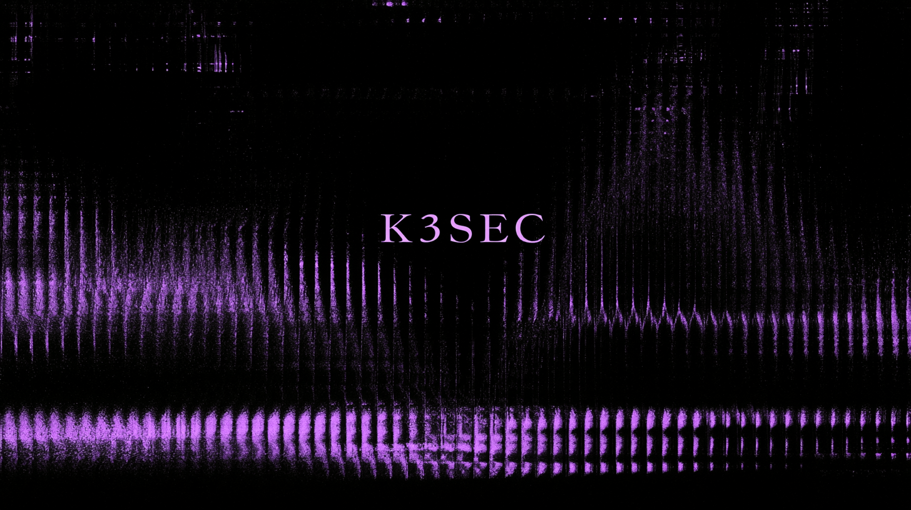

# k3sec

Runtime security CLI for **k3s** clusters, written in Rust.




> **Beta, under active development.** k3sec is not production-ready yet. Flags,
> the `SecEvent` schema, and internals may change between milestones without
> notice. Use it for testing and evaluation.

k3sec gives you a single real-time stream of what's happening in your cluster,
normalized into one event schema:

- **Kubernetes events** (watch API, no polling)
- **Pod logs** (`--logs`, multi-pod, follow)
- **Kernel runtime activity** via an **eBPF** probe (`--ebpf`): exec, outbound
  connects, and writes to sensitive paths, enriched with the pod/namespace they
  came from
- **YARA detections** (`--rules`): the scan engine flags malicious binaries and
  dropped files, inline in the same stream

Everything flows through the generic [`SecEvent`] envelope, so every source and
any downstream consumer speak the same format.

> **Realtime by default.** k3sec is a detection tool, not a history viewer. It
> shows what happens *after* you start watching. Use `--rollback` to replay the
> existing backlog first.

## Status

- **M1:** live k8s events & pod logs, pretty/JSON output. ✅
- **M2:** eBPF runtime probe (`exec` / `connect` / `file_write`), pod-enriched,
  via a ring buffer with in-kernel filtering. ✅ (build with `--features ebpf`).
- **M3:** YARA (yara-x) detection engine that scans exec'd binaries and files
  written to sensitive paths, off the probe's hot path, and emits detection
  events. ✅

## Install

Requires a recent stable Rust toolchain (2021 edition).

```bash
git clone https://github.com/mlab-sh/k3sec
cd k3sec
cargo build --release
# binary at ./target/release/k3sec
```

The eBPF probe is Linux-only and behind a feature flag. Building it needs a
nightly toolchain (to cross-compile the kernel program) and `bpf-linker`:

```bash
# One-time toolchain setup on the node (Linux, kernel 6.x, BTF enabled):
rustup toolchain install nightly
rustup component add rust-src --toolchain nightly
cargo install bpf-linker        # needs LLVM (apt install llvm clang)

# Build with the probe compiled in:
cargo build --release --features ebpf
```

The kernel program lives in `crates/k3sec-probe-ebpf` (its own standalone
workspace); `k3sec-probe`'s build script compiles it via `aya-build`. A normal
host build (no `--features ebpf`) never touches any of this.

## Usage

k3sec uses your current kubeconfig (`$KUBECONFIG`, then `~/.kube/config`), or an
explicit `--kubeconfig <path>`.

```bash
# Live events from all namespaces (realtime, pretty)
k3sec watch

# Replay existing events (sorted by time), then go live
k3sec watch --rollback

# One namespace only
k3sec watch --namespace default

# Also follow pod logs
k3sec watch --logs

# Kernel runtime events via eBPF (needs root or CAP_BPF+CAP_PERFMON)
sudo k3sec watch --ebpf

# Only exec + connect from the probe, as NDJSON
sudo k3sec watch --ebpf --kind exec,connect --output json

# Capture + YARA scanning + alerting, all in one command
sudo k3sec watch --ebpf --rules ./rules/
```

### Detection (YARA / yara-x)

With `--rules <file|dir>`, k3sec scans the artifacts the probe surfaces:

- **exec:** the executed binary (`/proc/<pid>/exe`), even if it's deleted right
  after. This is the priority case.
- **file_write:** the file dropped under a sensitive path (debounced, scanned
  once it settles).

Scanning runs on a bounded worker pool, off the probe's critical path, so a big
binary or a slow rule never blocks event capture. A match becomes a
`source: "yara"`, `kind: "detection"` event (critical severity, red in pretty)
carrying the pod/namespace, the matched rule name(s), tags, and the artifact
path. Rules are compiled once at startup; an invalid ruleset refuses to start
with a readable error. A starter `rules/` directory is included.

```bash
sudo k3sec watch --ebpf --rules ./rules/ --max-scan-size 33554432 --scan-workers 4
```

Flags (`k3sec watch --help`):

| Flag | Description | Default |
|------|-------------|---------|
| `-n, --namespace <NS>` | Restrict to one namespace | all namespaces |
| `--logs` | Follow pod container logs | off |
| `--ebpf` | Enable the eBPF runtime probe | off |
| `--kind <exec,connect,file_write>` | Restrict eBPF events to these kinds | all |
| `--rules <PATH>` | YARA rules file/dir; enables scanning (needs `--ebpf`) | off |
| `--max-scan-size <BYTES>` | Skip artifacts larger than this | 32 MiB |
| `--scan-workers <N>` | YARA worker threads | CPU count |
| `--rollback` | Replay backlog before going live | off (realtime) |
| `-o, --output <pretty\|json>` | Output format | `pretty` |
| `--kubeconfig <PATH>` | Kubeconfig file | `$KUBECONFIG` / `~/.kube/config` |

Internal diagnostics go to **stderr** (`RUST_LOG`, e.g. `RUST_LOG=k3sec=debug`);
event output goes to **stdout**, so JSON piping stays clean. **Ctrl+C** shuts
down gracefully.

### JSON output (NDJSON)

One `SecEvent` per line: a source-agnostic envelope shared by every source
(k8s events, logs, the eBPF probe, and YARA detections).

```jsonc
{
  "source": "ebpf",                    // k8s-event | k8s-log | ebpf | yara
  "timestamp": "2026-08-11T18:30:05Z",
  "kind": "exec",                      // event reason | "log" | exec|connect|file_write | "detection"
  "severity": "warning",
  "namespace": "default",
  "object": "pod/academy-...",
  "message": "...",
  "metadata": { /* flat string fields: pod, container, pid, ... */ },
  "payload": { /* raw source-specific detail */ }
}
```

## Robustness

- **No polling:** watch API for events and pods.
- **Auto-reconnect** with exponential backoff (1s to 30s) on watch drops.
- **Graceful shutdown** on Ctrl+C.
- **Readable errors** for kubeconfig, connectivity, and RBAC, with no panics.
- The eBPF and scan paths drop with a counter (never crash) on backpressure,
  an unresolved cgroup, or a vanished artifact.

## Architecture

A Cargo **workspace** of focused crates. The output pipeline is
source-agnostic: every collector implements `EventSource` and feeds one printer.

```
crates/
  k3sec-core/   SecEvent envelope, EventSource trait, pretty/NDJSON output
  k3sec-k8s/    K8sEventSource (events), K8sLogSource (logs)
  k3sec-probe/  EbpfSource (aya eBPF probe; Linux, feature = "ebpf")
  k3sec-engine/ YARA (yara-x) detection engine, depends only on k3sec-core
  k3sec/        the CLI binary (clap) wiring sources into the pipeline
```

The probe pushes lightweight scan requests into a queue; `k3sec-engine` drains
them on worker threads and emits detections back into the same pipeline. Neither
the probe nor the engine depends on the other; both meet at core types.

Adding a source (like the probe) never touches rendering. It just implements
`EventSource` and gets wired into the CLI.

## Development

```bash
cargo fmt --all
cargo clippy --all-targets -- -D warnings
cargo test --workspace
```

CI (GitHub Actions) runs fmt + clippy (deny warnings) + build + test.

[`SecEvent`]: crates/k3sec-core/src/event.rs
